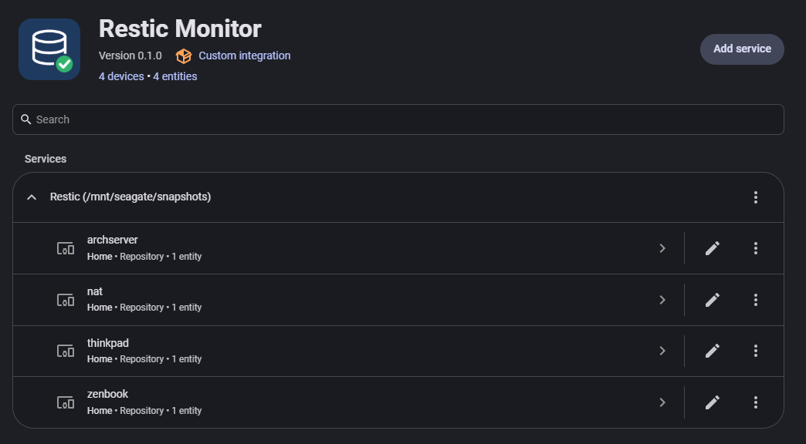
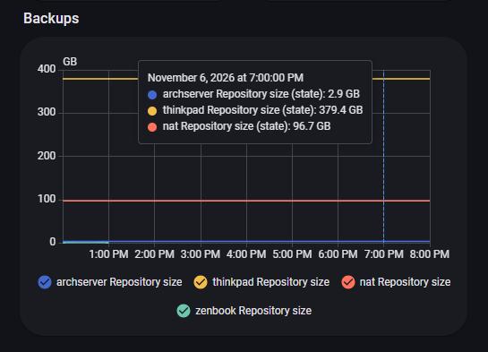

# Restic Monitor

Home Assistant integration that adds one sensor per [restic](https://restic.net) repository: its size, updated when a backup lands.

## Install

1. Add `ungaul/ha-restic-monitor` as a custom repository in the Marketplace (HACS), type Integration, then install and restart.
2. Mount the folder containing your repositories into the Home Assistant container, read-only:

```yaml
volumes:
  - /mnt/backup/restic:/snapshots:ro
```

3. Add the integration, enter that folder (`/snapshots`) and how often to read it (every 12 hours by default). Every repository found inside gets a sensor.



No password and no restic binary needed.

## Sensor

`sensor.<repository>_repository_size`

| State | Meaning |
|---|---|
| size | a snapshot was written today |
| no value (`unknown`) | no snapshot today, or repository unreadable |

Attributes: `last_snapshot`, `snapshot_count`, `error`. Values are refreshed at the chosen interval.

## Graph



```yaml
type: statistics-graph
entities:
  - sensor.thinkpad_repository_size
stat_types: [state]
period: day
days_to_show: 60
```

## Alert
You can make an automation to warn if no snapshot ran (here on a nightly run) like so:
```yaml
alias: Restic Check
description: ''
triggers:
  - trigger: time
    at: '05:00:00'
conditions:
  - condition: or
    conditions:
      - condition: state
        entity_id: sensor.home_archserver_repository_size
        state: unknown
      - condition: state
        entity_id: sensor.home_nat_repository_size
        state: unknown
      - condition: state
        entity_id: sensor.home_thinkpad_repository_size
        state: unknown
actions:
  - action: notify.notify
    data:
      message: No restic backup today
mode: single
```
